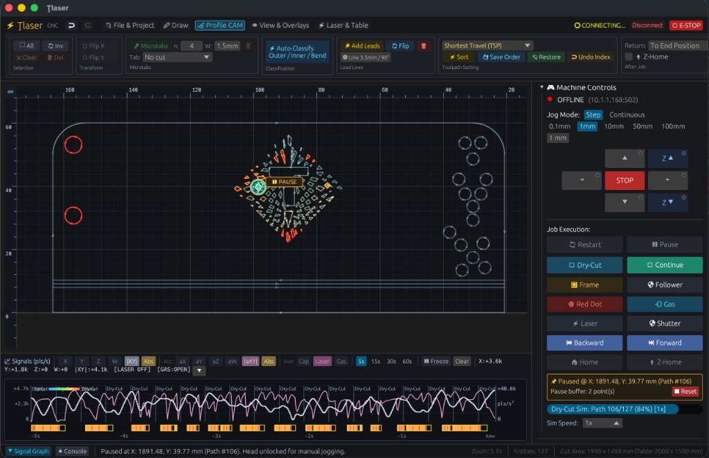

# Ţlaser (tzlaser)

Industrial fiber laser cutting control and CAM software written in Rust, targeting SC2000-compatible motion & capacitive height controller boards over Ethernet/UDP.



## Current Project Status

| Subsystem | Status | Notes |
|---|---|---|
| **Controller Connection** | Working | Auto-connects to XY motion controller (UDP `:502`) and Z/capacitive height controller (UDP `:999`) with live polling and heartbeat telemetry. |
| **Z + XY Homing** | Working | Sequential Z-up homing followed by corner XY homing (e.g. Bottom-Right `Xmax, Y0`) with configurable **Homing Speed** in Table Properties and auto-closing completion popup. |
| **Manual & Remote Jogging** | Working | On-screen arrow D-Pad (`X`, `Y`, `Z`, Step & Continuous modes), right-click **Go here** positioning, and wireless remote control (`R1042` bitmask decoding, including Fast mode). |
| **Manual I/O (Red Dot, Gas, Shutter, Laser)** | Working | Synchronized on-screen and wireless remote controls for **Red Dot** (`DO11`), **Gas** (`DO12`), **Shutter** (`DO9`), and hold-to-fire **Laser** (`DO10`, interlocked on Shutter). |
| **Stop / Emergency Halt** | Working | Both on-screen **Stop / E-STOP** and the wireless remote **Stop** button (`Bit 27` / `Bit 19`) immediately halt XY/Z motion, close gas/shutter/laser outputs, tear down active FIFO streams, and retract Z home. |
| **Nozzle Touch / Sheet Alarm** | Working | Port `999` capacitive short/sheet-touch detection (`d4 & 0x20`) triggers a UI alarm banner, blocks downward Z jogs and Start, and aborts active cuts with Z retraction. |
| **XY Dry-Cutting (Curves & Paths)** | Working | Continuous 4-kHz Motion FIFO streaming (`REG_FIFO_DATA`) with S-curve acceleration/deceleration ramps traces circles, arcs, splines, and sharp corners smoothly without step-by-step pauses. |
| **Offline Simulation & Signal Graph** | Working | Real-time head marker preview, rapid travel path rendering, pause/resume checkpoints, simulated Laser/Gas state during offline Dry-Cut, live velocity/acceleration telemetry (including `|XY|`, `|aXY|` norms and `Abs` mode), window-scaled Capacitance (pF), and Laser/Gas timeline bars. |
| **Live Laser Cutting & Capacitive Follower** | Working | Full 7-step contour cutting (XY rapid arrival -> Z capacitive follow -> assist gas -> shutter + `DO10` laser gate + per-tick 4-kHz FIFO PWM -> relative Z retract by `up_height_mm`, optional `gas_between_paths`), continuous inline microtab PWM modulation (laser-off or alternate-layer power without Z retract), and 180°-flipped arc lead-ins with configurable overcut. |

---

## Features & Functions

### CAD / CAM & Geometry (`tzlaser-core`)
- **DXF Importer**: Parses `LINE`, `LWPOLYLINE`, `POLYLINE`, `CIRCLE`, `ARC`, `ELLIPSE`, and `SPLINE` entities with full WCS/OCS arbitrary-axis transforms and adaptive arc/bulge tessellation.
- **Automatic Profile Classification & Grouping**: Classifies geometry into Outer profiles, Interior holes, and Bends; supports compound groups, scaling, rotation, mirroring, and undo/redo history.
- **Cut Sequence & Obstacle Routing**: Greedy nearest-neighbor TSP ordering prioritizing interior holes before outer contours, plus obstacle exclusion polygon offsetting and rapid-travel detour routing.
- **Lead-In / Lead-Out, Microtabs & Material Library**: Configurable linear/arc lead lines (180°-tangent arc entry with configurable overcut) and automatic inside/outside enclosure detection, equally distributed profile **Microtabs** (`No cut` laser-off gaps or custom target cutting/engraving layer overrides without Z retract), pierce times, layer cutting speeds, `up_height_mm`, `gas_between_paths`, and material/thickness presets.

### Hardware Protocol (`tzlaser-protocol`)
- **Port `502` (XY/W Motion Controller)**:
  - Custom Modbus-style UDP framing with little-endian CRC-16 (`crc.rs`, `packet.rs`).
  - Live 144-register status polling (`R1000..R1143`) for axis encoder positions (`R1008` X, `R1009` Y), hardware limit masks (`R1002`), FIFO free buffer (`R1006`), and wireless remote key bitmask (`R1042`).
  - Point-to-point / jog commands (`REG_JOG_MOTION = 116`), deceleration ramps (`REG_JOG_RAMP = 120`), homing (`REG_HOME_CMD = 112`), and 4-kHz continuous Motion FIFO streaming (`REG_FIFO_DATA = 100`).
  - Explicit shared axis/direction constants (`machine_directions`, `fifo_flags`) verified against Wireshark captures (`sharks/*.pcapng`).
- **Port `999` (Z-Axis & Capacitive Height Controller)**:
  - Modbus RTU over UDP for Z jogging, Z homing, Z stop, capacitive height calibration (`cmd = 7`), capacitive follow (`cmd = 4`), retract (`cmd = 3`), and nozzle-touch-sheet alarm detection (`d4 & 0x20`).

### Desktop GUI (`tzlaser-gui`)
- Built with `eframe` / `egui` featuring a dark industrial UI, exit confirmation dialog, ribbon toolbar, 2D vector canvas with origin/bed axes, directional arrowheads, cut-order badges, rapid travel path display, and right-click **Go here** / **Set starting point here** / **From this point continue** context menus.
- **Selection Transform HUD**: Precision move/scale/rotate, **Snap Origin to (0,0)**, and **Snap Origin to Head**.
- **CNC Control Panel**: Connect/disconnect, Home All / Home Z (with configurable Homing Speed), Step & Continuous jogging, **Start**, **Dry-Cut**, **Pause**, **Continue**, **Stop**, **Frame** (Rectangle, Convex Hull, or Concave Hull shrink-wrap), **Red Dot**, **Gas**, **Laser** (hold-to-fire), and **Shutter** controls.
- **Signal Graph & In-App Console**: Real-time axis velocity/acceleration plots (`X/Y/Z/W`, `|XY|`, `aX/aY/aZ/aW`, `|aXY|`, `Abs` toggles), window-scaled **Cap** (pF) overlay, **Laser** (power-quartile fill colored by frequency) and **Gas** timeline rectangles below the X-axis, plus a collapsible diagnostic message console.

---

## Prerequisites

- [Rust](https://rustup.rs/) (edition 2021)

## Running

```bash
cargo run -p tzlaser-gui
```

## Testing

```bash
cargo test --workspace
```

---

## License

This project is licensed under the [MIT License](LICENSE).

- **Attribution Required**: Any copy or substantial portion of this software must retain the copyright notice and permission notice from `LICENSE`.
- **No Warranty & No Liability**: This software is provided *"as is"*, without warranty of any kind. The authors and copyright holders shall in no event be held liable for any claim, damages, hardware failure, personal injury, or other liability arising from the use of this software. Always verify motion paths, machine limits, and laser safety interlocks before operating physical machinery.
